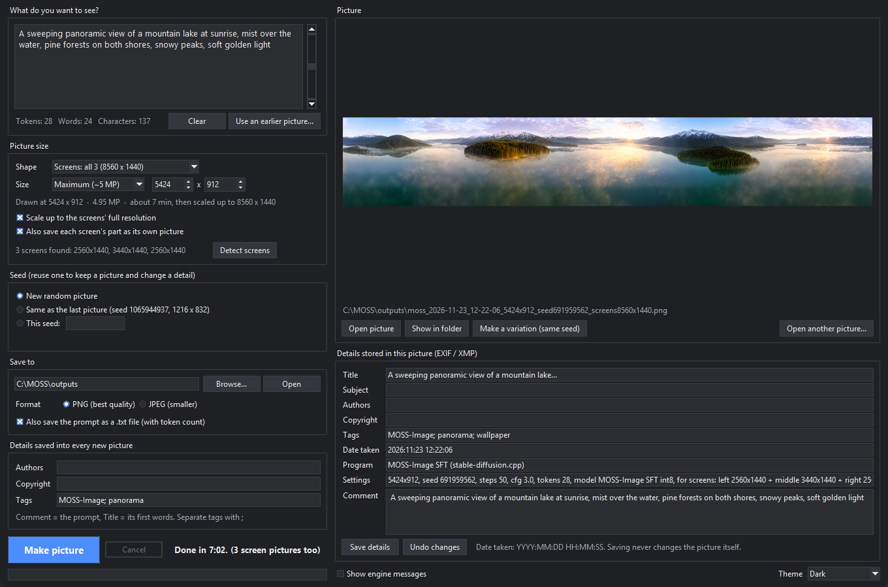
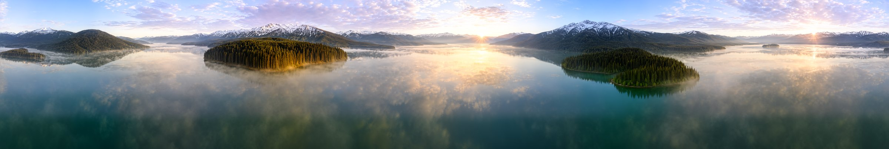

# MOSS-ImageGenerator

> Built on **[MOSS-Image](https://github.com/OpenMOSS/MOSS-Image)** by the OpenMOSS team. This project is an independent Windows app and installer for their model; it isn't affiliated with or endorsed by them. See [Acknowledgements](#acknowledgements).

**Make AI pictures on your own Windows PC: no cloud service, no account, no per-image cost.**

MOSS Image Studio is a desktop app for the open [MOSS-Image](https://github.com/OpenMOSS/MOSS-Image) text-to-image model from OpenMOSS. It can also use **FLUX.2 Klein** and **Qwen Image 2.1**, and it can **edit existing pictures** by instruction. Everything runs locally on an NVIDIA graphics card, except for the optional **Nano Banana** cloud model, which runs through [stable-diffusion.cpp](https://github.com/leejet/stable-diffusion.cpp). Nano Banana runs on Google's servers with your own API key. Type what you want to see, pick a size, and the picture is made on your machine.



## Features

- **Four models in one app.** Pick one from the **Model** list:

  | Model | Good at | Speed (1 MP picture) | Edits pictures | License |
  | --- | --- | --- | --- | --- |
  | **MOSS-Image SFT** (installed by default) | Detailed scenes, readable text | about 40 s | Yes | Apache-2.0 |
  | **FLUX.2 Klein 4B** (optional, 8.6 GB) | Photos and general pictures, very fast | about 10 s | Yes | Apache-2.0 |
  | **Qwen Image 2.1** (optional, 14 GB) | Text in pictures, complex layouts | about 40 s | Yes\* | Qwen Research (non-commercial) |

  | **Nano Banana 2.1** (optional, Google cloud) | Following detailed instructions, editing | usually 10-40 s | Yes | Google Gemini API terms; about $0.03-0.11 per picture |

  \*Qwen edits normal pictures well, in about 50 s at 1 MP. Very dark pictures can come out over-brightened, so use MOSS or FLUX for those.
- **Edit a picture by instruction.** Choose **Edit a picture**, pick any PNG or JPEG, and describe the change, e.g. *"Change only the orange cat to a black cat. Keep everything else unchanged."* The rest of the picture stays as it was.
- **Set as wallpaper.** Put a picture on your desktop: one slice per monitor, spanned across all of them, the same picture everywhere, or one screen only. **Put my previous wallpaper back** undoes it.
- **Wallpaper of the day.** Optionally makes a fresh wallpaper every morning from your prompts, varied by the prompt enhancer, and sets it. It's off until you turn it on.
- **AI upscaling.** Real-ESRGAN makes screen panoramas sharp instead of soft when they're enlarged to full resolution. **Upscale** also makes a 2x or 4x copy of any picture.
- **Gallery.** Browse everything you've made, search by prompt, filter by model. Right-click a picture to reuse its settings, edit it, describe it or open it.
- **Improve a prompt.** Turns a short idea into a detailed prompt, locally (Qwen 3.5) or with Gemini.
- **Queue, variations and compare.** Queue several pictures to run one after another, make 4 variations with different seeds, or **compare models** with the same prompt side by side.
- **Paint to edit.** In Edit mode, paint over just the area to change and describe what goes there. Everything you didn't paint is kept pixel for pixel, so text and details there can't change.
- **Text check.** When your prompt has words in "quotes", the app reads them back from the finished picture with the local Qwen3-VL vision model. If they're misspelled, it tries again with a new seed (up to 3 tries) and keeps the best one. It works with the models on this PC and adds about 5 seconds per picture.
- **Advanced settings** per model: steps, guidance, sampler, a negative prompt, kept line breaks (to control text layout), and **style LoRAs**.
- **Layout boxes (MOSS).** Draw boxes to place things and text exactly where you want them, using MOSS-Image's own layout format.
- **Low-memory warning** before a big job if Windows is short on memory, instead of failing partway.
- **Phone access.** Make pictures from your phone's browser over your home network or WireGuard. It's password-protected and off until you turn it on.
- **Write a prompt from any picture.** Pick a photo or an AI picture and the app writes a detailed prompt that recreates it, in a form all four models understand. Any readable text is copied in quotes.
  - It runs locally by default (free, private) with [llama.cpp](https://github.com/ggml-org/llama.cpp) and the Qwen vision files you already have; about 5-10 seconds.
  - Or use Google Gemini 3.5 Flash-Lite with your API key, about $0.001 per picture.
- **Check for updates.** Compares every downloaded model file with its source on Hugging Face (by SHA-256 checksum), and the two engines with their latest GitHub releases.
  - Updates install verified. Model files keep the old copy until the new one passes its checksum.
  - Engines are tested after installing and put back automatically if the test fails. There's also an **Undo** button for the image engine.
- **Prompt box with a live token count.** It counts with MOSS's own Qwen 3.5 tokenizer (exact for MOSS, close for the other models) and handles long, multi-line prompts with quotes and special characters.
- **Sizes and shapes.** Presets for common shapes (16:9, 9:16, 1:1, 4:3, 3:2, 21:9 ...) at four sizes, from about 1 MP (around a minute) up to about 5 MP, e.g. 3440 x 1440. You can also type a custom size.
- **Pictures that fit your screens.** The app detects your monitors and offers:
  - each screen on its own;
  - neighbouring screens together;
  - all of them as one panorama.

  Spanned pictures are drawn at the screens' exact shape and scaled up to full resolution. Each screen's part can also be saved as its own wallpaper file.
- **Change a detail, keep the picture.** Reuse a seed (the random number behind a picture) with a slightly changed prompt, and you get nearly the same picture with that one thing changed. There's a one-click **Make a variation** button, and you can load the prompt, size and seed from any earlier picture.
- **Details saved inside each picture** (EXIF / XMP):
  - title, authors, copyright and tags;
  - the date;
  - the generation settings;
  - **the full prompt as the Comment**.

  Windows File Explorer shows them under *Properties > Details*. A built-in editor changes them on any PNG or JPEG without touching the picture itself.
- **Output choices.** Save to any folder, as PNG or JPEG, optionally with a `.txt` file holding the prompt and its token count.
- **Light and dark themes**, or follow the Windows setting.
- **Progress and control.** Live step-by-step progress, a time estimate for each size, and Cancel.

## Examples

All of these were made locally on an RTX 4070 Ti SUPER.

A three-screen panorama (8560 x 1440, shown scaled down), made with MOSS-Image:



The same prompt with FLUX.2 Klein, at the same size, in 28 seconds:


**Edit a picture** with FLUX.2 Klein (*"Change only the orange cat to a black cat"*, 10 seconds):

| Original | Edited |
| --- | --- |
|  |  |

Same seed, one word changed (*orange cat* to *black cat*):

| Original | Same seed, "black cat" |
| --- | --- |
|  |  |

## Requirements

- Windows 10 or 11, 64-bit.
- An NVIDIA graphics card, ideally with 16 GB of memory; it's built and tested on an RTX 4070 Ti SUPER. On smaller cards the installer may fall back to a smaller model; see *Troubleshooting*.
- About 13 GB of free disk space for the engine and MOSS-Image, plus 8.6 GB for FLUX and 14 GB for Qwen if you add them.
- An internet connection for the one-time download.

## Quick start

1. **Download this repo**: *Code > Download ZIP* and unzip it, or `git clone` it.
2. **Run the installer** from the repo folder. It downloads the engine and models (about 12 GB) into a `moss-image-pc` folder next to itself and makes a test picture. If the download is interrupted, run it again and it resumes.

   ```powershell
   powershell -ExecutionPolicy Bypass -File .\installer-moss-image.ps1
   ```

3. **Download `MOSS-Image-Studio.exe`** from the [Releases page](../../releases/latest). Put it in the `moss-image-pc` folder, or in the repo folder next to it, and double-click it. A desktop shortcut to it is handy.

   The `.exe` isn't code-signed. The first time you run it, Windows SmartScreen may say *"Windows protected your PC"*; click **More info > Run anyway**.

4. **Optional: add more models.** Run `download-models.ps1` and pick any of:
   - the editing add-on for MOSS (1.4 GB);
   - FLUX.2 Klein (8.6 GB);
   - Qwen Image 2.1 (14 GB);
   - the AI upscaler, Real-ESRGAN (67 MB).

   Each download is checked against Hugging Face's published size and checksum.

   ```powershell
   powershell -ExecutionPolicy Bypass -File .\download-models.ps1
   ```

5. **Optional: Nano Banana (Google cloud).** This model runs on Google's servers, not your PC.
   1. Get a Gemini API key at [aistudio.google.com/apikey](https://aistudio.google.com/apikey). Image generation needs billing turned on.
   2. In the app, choose **Nano Banana 2.1** and click **API key...**. The key is stored encrypted, readable only by your Windows account. Setting the `GEMINI_API_KEY` environment variable works too.

   Each picture is billed to your key: about $0.03 at 1K, $0.05 at 2K, $0.11 at 4K. Your prompt, and the picture when editing, is sent to Google, and Google adds its invisible SynthID watermark. Nano Banana has no seeds, so every picture is new.

If the app opens with a message that the engine or models weren't found, it's in the wrong folder or the installer hasn't finished. The message lists exactly what's missing.

## Using it

1. Pick a **Model**. Models you haven't downloaded yet are marked *(not downloaded)*.
2. Type or paste a prompt. Longer, descriptive prompts work well: say what's in the scene, the lighting and the style.
3. Pick a **Shape** and **Size**, or one of your screens.
4. Click **Make picture** (or press Ctrl+Enter). The estimate under the size shows how long the chosen model should take.
5. The picture appears on the right with its details. **Open picture** and **Show in folder** are below it.

**To start from an existing picture**, click **Start from ▾ > Write a prompt from a picture...** under the prompt, or **Write a prompt from this** under the picture shown:
1. Choose the picture and the describer: Qwen on this PC, or Gemini in the cloud.
2. Pick **Detailed** or **Short**.
3. Click **Write prompt**. Edit the result if you like, then click **Use as prompt**.

The first time, the local describer offers to download llama.cpp (about 360 MB) from its official releases. It reuses the Qwen 3.5 vision files from the MOSS editing add-on, or Qwen Image's Qwen3-VL files.

**To improve a short prompt**, click **Improve** under the prompt box. Check the result, then click **Use**.

**To make several pictures:** **Queue ▾** next to Make picture has these options:
- **Add to the queue:** queue the current settings to run later.
- **Make 4 variations:** the same prompt with four different seeds.
- **Compare models:** the same prompt with each model you tick, shown side by side.

**More ▾ > Queue** shows what's waiting and what's done.

**For wallpapers**, choose one of your screens (or **Screens: all**) as the Shape, then make the picture. Click **Set as wallpaper ▾** and choose **One per screen** for the sharpest result. To get a new one every day, use **More ▾ > Wallpaper of the day**.

**To change only part of a picture**, choose **Edit a picture**, then **Paint area...**. Paint over the part to change (right-click erases), click **Use this area**, describe what should be there, and click **Edit picture**. Everything outside the painted area stays exactly as it was.

**To get text spelled right**, put the exact words in "quotes" and leave **Check that words in "quotes" come out right** ticked under the prompt. These things help most:
- **Qwen Image** or **Nano Banana**: they're much better at text than FLUX.2 Klein or MOSS;
- short quoted text;
- the **Standard** size, then **Scale up** for screens.

To make an existing picture sharper without redrawing it, use **Upscale ▾** instead; it can't change the words.

**To place things exactly (MOSS)**, open **Start from ▾ > Layout boxes**:
1. Drag boxes on the canvas.
2. Describe each box. Text boxes also get the exact words to write.
3. Describe the whole picture, then click **Use layout as prompt**.

Keep the same picture size when you make it.

**Advanced settings** are under **More ▾ > Advanced settings**:
- steps, guidance, sampler, negative prompt and line breaks;
- a **style LoRA** with its strength.

Put LoRA `.safetensors` files in `models\loras\styles`, and only use a LoRA with the model it was made for.

**To use it from your phone**, open **More ▾ > Phone access**, set a password and turn it on. Open the address it shows in your phone's browser, on the same network or over your WireGuard tunnel. The app must be running on your PC. If Windows asks whether to allow network access, allow it for private networks.

**To check for updates**, click **More ▾ > Check for updates...**. The first check reads every model file once (about half a minute); later checks take a second. Tick what to install, then click **Install selected**.

**To change one detail**, there are two ways:

- **Edit a picture** (any model; MOSS needs its editing add-on):
  1. Choose **Edit a picture** at the top, then **Use the picture shown** or **Choose...**.
  2. Describe only the change, e.g. *"Change only the X to Y. Keep everything else unchanged."*
  3. Click **Edit picture**. The new picture keeps the original's size and gets `_edit` in its name.
- **Same seed:** click **Make a variation (same seed)**, edit a few words of the prompt and make it again. The fewer words you change, the closer the picture stays.

Pictures are saved in `moss-image-pc\outputs` unless you choose another folder. The app remembers your choices in `moss-image-pc\tools\gui_settings.json`.

## Other ways to run it

**From source, instead of the `.exe`.** You need Python 3.10 or newer:

```powershell
cd moss-image-pc
python -m venv tools\venv
tools\venv\Scripts\python -m pip install -r tools\requirements.txt
tools\venv\Scripts\pythonw.exe tools\moss_gui.py
```

**Command-window launcher.** `moss-image-pc\MOSS Image.bat` is a simple text version:

1. Paste a prompt (several lines are fine) and type `/go`.
2. Pick a size.
3. Pick a seed: press Enter for random, type `last` to reuse the last picture's seed, or type a number.

## Building the .exe

```powershell
powershell -ExecutionPolicy Bypass -File .\packaging\build-exe.ps1
```

This builds `dist\MOSS Image Studio.exe` with PyInstaller, in its own build environment. To check a build end to end, run:

```powershell
& ".\dist\MOSS Image Studio.exe" --selftest .\selftest
```

It makes one small picture through the app and writes `selftest-result.json`.

## Troubleshooting

- **"Engine or models not found."** Run the installer, then put the `.exe` in `moss-image-pc` or the folder above it.
- **"Ran out of memory" on big sizes.** The app says how much memory Windows has free. To fix it:
  - Pick a smaller Size, or switch to FLUX, which needs the least memory.
  - Restart Windows if it has been running for days. Some Windows services slowly hold on to more and more memory, and the engine checks how much Windows can still promise before it starts.

  Pictures over 2 MP are already decoded in tiles to save memory.
- **Antivirus warning about the `.exe`.** Some antivirus tools are wary of programs packaged with PyInstaller. You can build it yourself (see above) or run from source.
- **The installer fell back to the GGUF model.** The app and launcher expect the int8 model (`moss_image_sft_int8_convrot.safetensors`). Change the MOSS model file name in `PROFILES` near the top of `moss_gui.py`, and in `MOSS Image.bat`.
- **A model is marked *(not downloaded)*, or Edit says files are missing.** Run `download-models.ps1` and pick that model or the MOSS editing add-on.
- **Nano Banana says the key wasn't accepted (401), isn't allowed (403) or is out of quota (429).** Check the key at [aistudio.google.com/apikey](https://aistudio.google.com/apikey) and that billing is turned on. Google has no free tier for image output.
- **Nano Banana returned no picture.** Google's content rules blocked the prompt. The app shows any reason Google gave.
- **"Write prompt" says the local describer isn't available.** Choose its *get the local describer* option to download llama.cpp. You also need the MOSS editing add-on or Qwen Image 2.1 from `download-models.ps1`, since those include the vision files it uses.
- **My wallpaper changed and I want the old one back.** Choose **More ▾ > Put my previous wallpaper back**, or the same item under **Set as wallpaper ▾**.
- **The phone can't reach the app.** Check these:
  - phone access is on, set to *my network or WireGuard*;
  - the phone is on the same network or connected through WireGuard;
  - Windows Firewall allows the app on private networks.

  The page uses plain HTTP, so only use it on networks you trust or through the tunnel.
- **The words come out misspelled.** If the text check still can't get them right in 3 tries, it keeps the closest one and tells you what it read. Try Qwen Image, shorten the quoted text, or make it at Standard size. The check needs the Qwen3-VL files that come with Qwen Image; without them it uses Qwen 3.5, which is less exact.
- **A style LoRA does nothing or makes a mess.** It was probably made for a different model. Use it only with the model it was made for.
- **An engine update failed its test.** The app puts the previous version back automatically and says so. Nothing else is needed; try again after the next release.
- **A Qwen edit looks over-brightened or harsh.** This happens with very dark pictures. Use MOSS or FLUX for those.

## What's in this repo

| Path | What it is |
| --- | --- |
| `installer-moss-image.ps1` | Downloads and sets up the engine and MOSS-Image, and makes a test picture |
| `download-models.ps1` | Downloads the optional models: MOSS editing add-on, FLUX.2 Klein, Qwen Image 2.1 |
| `moss-image-pc/tools/moss_gui.py` | MOSS Image Studio |
| `moss-image-pc/tools/moss_describe.py` | Write a prompt from a picture: local (llama.cpp + Qwen vision) or Gemini |
| `moss-image-pc/tools/moss_updates.py` | Checks and installs model and engine updates, verified, with undo |
| `moss-image-pc/tools/moss_extras.py` | Gallery, queue and compare, enhancer, upscaling, wallpaper of the day, paint-to-edit, layout boxes, advanced settings, phone access window |
| `moss-image-pc/tools/moss_wallpaper.py` | Sets Windows wallpapers per monitor or spanned (IDesktopWallpaper), with undo |
| `moss-image-pc/tools/moss_remote.py` | The password-protected phone web page |
| `moss-image-pc/tools/moss_cloud.py` | Nano Banana: Google Gemini API requests and the encrypted API key |
| `moss-image-pc/tools/moss_meta.py` | Reads and writes picture details (EXIF / XMP / PNG text) |
| `moss-image-pc/tools/prompt_info.py` | Token counter and prompt `.txt` writer used by the launcher |
| `moss-image-pc/MOSS Image.bat` | Command-window launcher |
| `packaging/` | Build script and version info for the `.exe` |
| `docs/images/` | Screenshots and examples for this page |

The engine, models, your pictures and settings are not stored in the repo.

## Acknowledgements

This project is built on **[MOSS-Image](https://github.com/OpenMOSS/MOSS-Image)** by the OpenMOSS team: a 5B-parameter image model with strong text rendering and layout generation. All of the picture-making ability comes from their model. This repo only adds a Windows installer, a launcher and a desktop app around it.

- MOSS-Image code and model weights: [OpenMOSS/MOSS-Image](https://github.com/OpenMOSS/MOSS-Image) on GitHub, [OpenMOSS-Team/MOSS-Image-SFT](https://huggingface.co/OpenMOSS-Team/MOSS-Image-SFT) on Hugging Face. Licensed under Apache-2.0.
- The int8 model files the installer downloads come from [Comfy-Org/MOSS-Image](https://huggingface.co/Comfy-Org/MOSS-Image).

If you use MOSS-Image in your work, please cite the MOSS-Image technical report:

```bibtex
@misc{ai2026mossimagetechnicalreport,
      title={MOSS-Image Technical Report},
      author={MOSI. AI},
      year={2026},
      eprint={2610.23374},
      archivePrefix={arXiv},
      primaryClass={cs.CV},
      url={https://arxiv.org/abs/2610.23374},
}
```

MOSS editing uses the [MOSS-Image-Edit-HQ](https://huggingface.co/akhaliq/MOSS-Image-Edit-HQ) LoRA (`armV5`, Apache-2.0).

The optional models belong to their makers:

- **[FLUX.2 Klein 4B](https://huggingface.co/black-forest-labs/FLUX.2-klein-4B)** by Black Forest Labs (Apache-2.0).
  - GGUF build by [leejet](https://huggingface.co/leejet/FLUX.2-klein-4B-GGUF).
  - Text encoder: [Qwen3-4B](https://huggingface.co/unsloth/Qwen3-4B-GGUF).
- **[Qwen Image 2.1](https://huggingface.co/Qwen/Qwen-Image-2.1)** by the Qwen team (Qwen Research license: non-commercial use).
  - Files from [Comfy-Org/Qwen-Image-2.1](https://huggingface.co/Comfy-Org/Qwen-Image-2.1).
  - Text encoder: [Qwen3-VL-8B](https://huggingface.co/Qwen/Qwen3-VL-8B-Instruct-GGUF).

**[Nano Banana](https://aistudio.google.com/docs/image-generation)** (Gemini image models) is Google's. It runs on Google's servers under the Gemini API terms, with each user's own API key.

This project also relies on:

- [stable-diffusion.cpp](https://github.com/leejet/stable-diffusion.cpp) by leejet and contributors (MIT): the engine that runs the models
- [llama.cpp](https://github.com/ggml-org/llama.cpp) by ggml-org and contributors (MIT): runs the local picture describer and prompt enhancer, with Qwen 3.5 or Qwen3-VL
- [Real-ESRGAN](https://github.com/xinntao/Real-ESRGAN) by Xintao Wang et al. (BSD-3-Clause): the AI upscaler (x4plus model)
- [Qwen3.5-9B](https://huggingface.co/unsloth/Qwen3.5-9B-GGUF) (GGUF build by unsloth): the text encoder
- FLUX.2 VAE: the image decoder
- Python, Tk, [Pillow](https://python-pillow.org) and Hugging Face [tokenizers](https://github.com/huggingface/tokenizers), bundled in the `.exe`

None of the third-party model files or engine binaries are stored in this repo. The installer downloads them from their original sources, and each keeps its own license.

## License

The code in this repo is licensed under the **GNU General Public License v3.0**; see [LICENSE](LICENSE). That license covers only the code in this repo, not MOSS-Image or the other projects above.

<details>
<summary>Light theme</summary>


</details>
