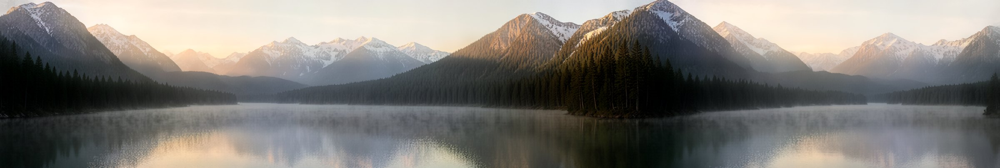
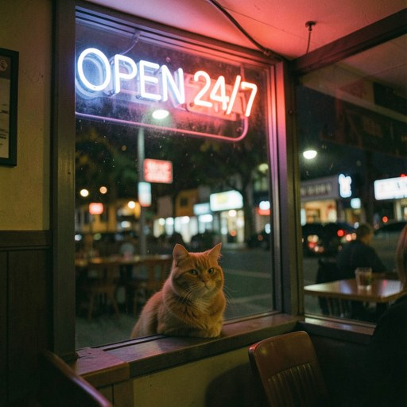
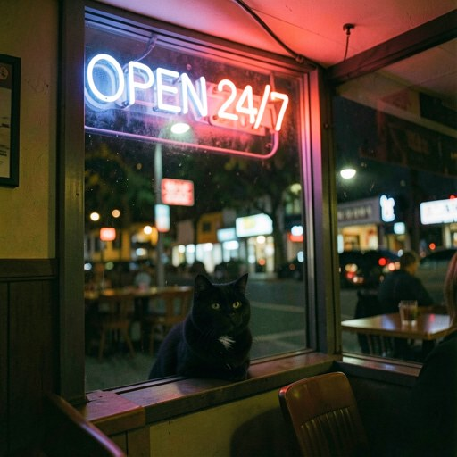
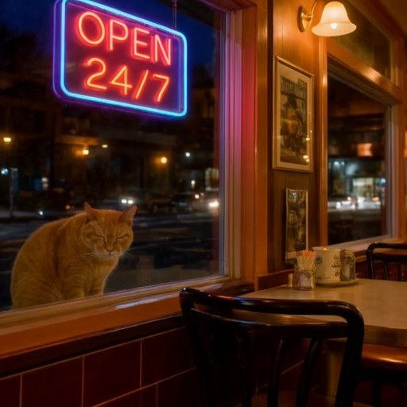
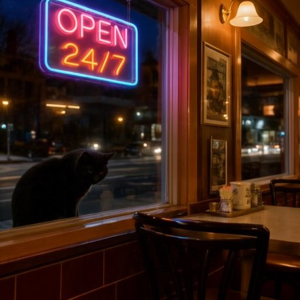
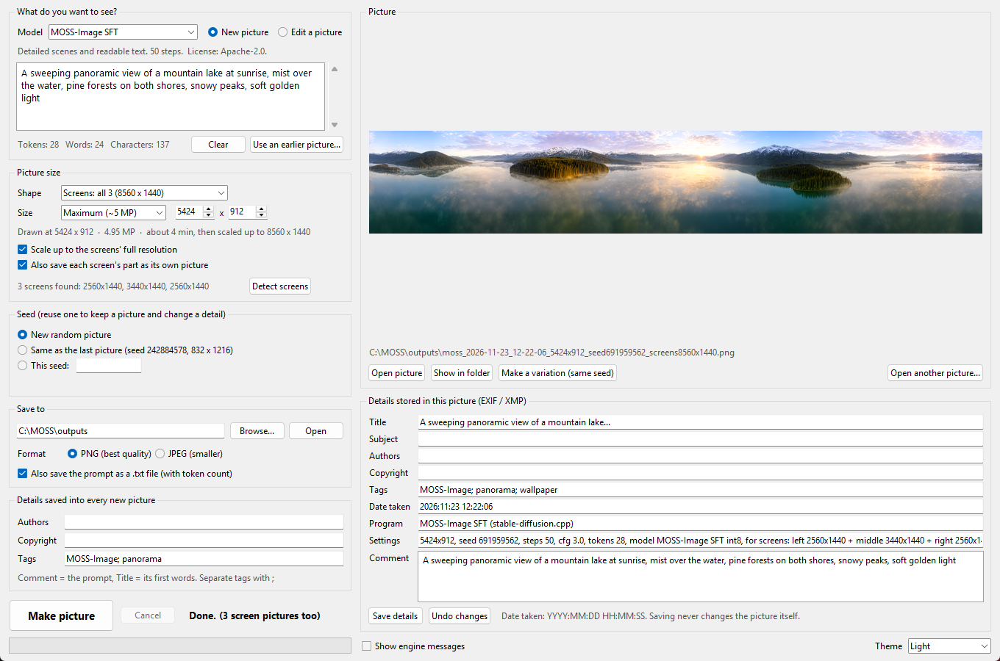

# MOSS-ImageGenerator

> Built on **[MOSS-Image](https://github.com/OpenMOSS/MOSS-Image)** by the OpenMOSS team. This project is an independent Windows app and installer for their model; it isn't affiliated with or endorsed by them. See [Acknowledgements](#acknowledgements).

**Make AI pictures on your own Windows PC: no cloud service, no account, no per-image cost.**

MOSS Image Studio is a desktop app for the open [MOSS-Image](https://github.com/OpenMOSS/MOSS-Image) text-to-image model from OpenMOSS. It can also use **FLUX.2 Klein** and **Qwen Image 2.1**, and it can **edit existing pictures** by instruction. Everything runs locally on an NVIDIA graphics card through [stable-diffusion.cpp](https://github.com/leejet/stable-diffusion.cpp). Type what you want to see, pick a size, and the picture is made on your machine.


## Features

- **Three models in one app.** Pick one from the **Model** list:

  | Model | Good at | Speed (1 MP picture) | Edits pictures | License |
  | --- | --- | --- | --- | --- |
  | **MOSS-Image SFT** (installed by default) | Detailed scenes, readable text | about 40 s | Yes | Apache-2.0 |
  | **FLUX.2 Klein 4B** (optional, 8.6 GB) | Photos and general pictures, very fast | about 10 s | Yes | Apache-2.0 |
  | **Qwen Image 2.1** (optional, 13 GB) | Text in pictures, complex layouts | about 40 s | Not yet\* | Qwen Research (non-commercial) |

  \*Qwen Image 2.1 can edit in principle, but it needs more memory than a 16 GB card here, so the app only uses it for new pictures.
- **Edit a picture by instruction.** Choose **Edit a picture**, pick any PNG or JPEG, and describe the change, e.g. *"Change only the orange cat to a black cat. Keep everything else unchanged."* The rest of the picture stays as it was.
- **Prompt box with a live token count.** It counts with MOSS's own Qwen 3.5 tokenizer (exact for MOSS, close for the other models) and handles long, multi-line prompts with quotes and special characters.
- **Sizes and shapes.** Presets for common shapes (16:9, 9:16, 1:1, 4:3, 3:2, 21:9 ...) at four sizes, from about 1 MP (around a minute) up to about 5 MP, e.g. 3440 x 1440. You can also type a custom size.
- **Pictures that fit your screens.** The app detects your monitors and offers:
  - each screen on its own;
  - neighbouring screens together;
  - all of them as one panorama.

  Spanned pictures are drawn at the screens' exact shape and scaled up to full resolution. Each screen's part can also be saved as its own wallpaper file.
- **Change a detail, keep the picture.** Reuse a seed (the random number behind a picture) with a slightly changed prompt, and you get nearly the same picture with that one thing changed. There's a one-click **Make a variation** button, and you can load the prompt, size and seed from any earlier picture.
- **Details saved inside each picture** (EXIF / XMP):
  - title, authors, copyright and tags;
  - the date;
  - the generation settings;
  - **the full prompt as the Comment**.

  Windows File Explorer shows them under *Properties > Details*. A built-in editor changes them on any PNG or JPEG without touching the picture itself.
- **Output choices.** Save to any folder, as PNG or JPEG, optionally with a `.txt` file holding the prompt and its token count.
- **Light and dark themes**, or follow the Windows setting.
- **Progress and control.** Live step-by-step progress, a time estimate for each size, and Cancel.

## Examples

All of these were made locally on an RTX 4070 Ti SUPER.

A three-screen panorama (8560 x 1440, shown scaled down), made with MOSS-Image:


The same prompt with FLUX.2 Klein, at the same size, in 28 seconds:



**Edit a picture** with FLUX.2 Klein (*"Change only the orange cat to a black cat"*, 10 seconds):

| Original | Edited |
| --- | --- |
|  |  |

Same seed, one word changed (*orange cat* to *black cat*):

| Original | Same seed, "black cat" |
| --- | --- |
|  |  |

## Requirements

- Windows 10 or 11, 64-bit.
- An NVIDIA graphics card, ideally with 16 GB of memory; it's built and tested on an RTX 4070 Ti SUPER. On smaller cards the installer may fall back to a smaller model; see *Troubleshooting*.
- About 13 GB of free disk space for the engine and MOSS-Image, plus 8.6 GB for FLUX and 13 GB for Qwen if you add them.
- An internet connection for the one-time download.

## Quick start

1. **Download this repo**: *Code > Download ZIP* and unzip it, or `git clone` it.
2. **Run the installer** from the repo folder. It downloads the engine and models (about 12 GB) into a `moss-image-pc` folder next to itself and makes a test picture. If the download is interrupted, run it again and it resumes.

   ```powershell
   powershell -ExecutionPolicy Bypass -File .\installer-moss-image.ps1
   ```

3. **Download `MOSS-Image-Studio.exe`** from the [Releases page](../../releases/latest). Put it in the `moss-image-pc` folder, or in the repo folder next to it, and double-click it. A desktop shortcut to it is handy.

   The `.exe` isn't code-signed. The first time you run it, Windows SmartScreen may say *"Windows protected your PC"*; click **More info > Run anyway**.

4. **Optional: add more models.** Run `download-models.ps1` and pick any of:
   - the editing add-on for MOSS (1.4 GB);
   - FLUX.2 Klein (8.6 GB);
   - Qwen Image 2.1 (13 GB).

   Each download is checked against Hugging Face's published size and checksum.

   ```powershell
   powershell -ExecutionPolicy Bypass -File .\download-models.ps1
   ```

If the app opens with a message that the engine or models weren't found, it's in the wrong folder or the installer hasn't finished. The message lists exactly what's missing.

## Using it

1. Pick a **Model**. Models you haven't downloaded yet are marked *(not downloaded)*.
2. Type or paste a prompt. Longer, descriptive prompts work well: say what's in the scene, the lighting and the style.
3. Pick a **Shape** and **Size**, or one of your screens.
4. Click **Make picture** (or press Ctrl+Enter). The estimate under the size shows how long the chosen model should take.
5. The picture appears on the right with its details. **Open picture** and **Show in folder** are below it.

**To change one detail**, there are two ways:

- **Edit a picture** (MOSS with the editing add-on, or FLUX):
  1. Choose **Edit a picture** at the top, then **Use the picture shown** or **Choose...**.
  2. Describe only the change, e.g. *"Change only the X to Y. Keep everything else unchanged."*
  3. Click **Edit picture**. The new picture keeps the original's size and gets `_edit` in its name.
- **Same seed:** click **Make a variation (same seed)**, edit a few words of the prompt and make it again. The fewer words you change, the closer the picture stays.

Pictures are saved in `moss-image-pc\outputs` unless you choose another folder. The app remembers your choices in `moss-image-pc\tools\gui_settings.json`.

## Other ways to run it

**From source, instead of the `.exe`.** You need Python 3.10 or newer:

```powershell
cd moss-image-pc
python -m venv tools\venv
tools\venv\Scripts\python -m pip install -r tools\requirements.txt
tools\venv\Scripts\pythonw.exe tools\moss_gui.py
```

**Command-window launcher.** `moss-image-pc\MOSS Image.bat` is a simple text version:

1. Paste a prompt (several lines are fine) and type `/go`.
2. Pick a size.
3. Pick a seed: press Enter for random, type `last` to reuse the last picture's seed, or type a number.

## Building the .exe

```powershell
powershell -ExecutionPolicy Bypass -File .\packaging\build-exe.ps1
```

This builds `dist\MOSS Image Studio.exe` with PyInstaller, in its own build environment. To check a build end to end, run:

```powershell
& ".\dist\MOSS Image Studio.exe" --selftest .\selftest
```

It makes one small picture through the app and writes `selftest-result.json`.

## Troubleshooting

- **"Engine or models not found."** Run the installer, then put the `.exe` in `moss-image-pc` or the folder above it.
- **Running out of graphics memory on big sizes.** Pick a smaller Size. Pictures over 2 MP are already decoded in tiles to save memory.
- **Antivirus warning about the `.exe`.** Some antivirus tools are wary of programs packaged with PyInstaller. You can build it yourself (see above) or run from source.
- **The installer fell back to the GGUF model.** The app and launcher expect the int8 model (`moss_image_sft_int8_convrot.safetensors`). Change the MOSS model file name in `PROFILES` near the top of `moss_gui.py`, and in `MOSS Image.bat`.
- **A model is marked *(not downloaded)*, or Edit says files are missing.** Run `download-models.ps1` and pick that model or the MOSS editing add-on.
- **Qwen Image 2.1 in Edit mode.** Qwen can't edit in this app yet because it runs out of memory on a 16 GB card. Use MOSS or FLUX for editing.

## What's in this repo

| Path | What it is |
| --- | --- |
| `installer-moss-image.ps1` | Downloads and sets up the engine and MOSS-Image, and makes a test picture |
| `download-models.ps1` | Downloads the optional models: MOSS editing add-on, FLUX.2 Klein, Qwen Image 2.1 |
| `moss-image-pc/tools/moss_gui.py` | MOSS Image Studio |
| `moss-image-pc/tools/moss_meta.py` | Reads and writes picture details (EXIF / XMP / PNG text) |
| `moss-image-pc/tools/prompt_info.py` | Token counter and prompt `.txt` writer used by the launcher |
| `moss-image-pc/MOSS Image.bat` | Command-window launcher |
| `packaging/` | Build script and version info for the `.exe` |
| `docs/images/` | Screenshots and examples for this page |

The engine, models, your pictures and settings are not stored in the repo.

## Acknowledgements

This project is built on **[MOSS-Image](https://github.com/OpenMOSS/MOSS-Image)** by the OpenMOSS team: a 5B-parameter image model with strong text rendering and layout generation. All of the picture-making ability comes from their model. This repo only adds a Windows installer, a launcher and a desktop app around it.

- MOSS-Image code and model weights: [OpenMOSS/MOSS-Image](https://github.com/OpenMOSS/MOSS-Image) on GitHub, [OpenMOSS-Team/MOSS-Image-SFT](https://huggingface.co/OpenMOSS-Team/MOSS-Image-SFT) on Hugging Face. Licensed under Apache-2.0.
- The int8 model files the installer downloads come from [Comfy-Org/MOSS-Image](https://huggingface.co/Comfy-Org/MOSS-Image).

If you use MOSS-Image in your work, please cite the MOSS-Image technical report:

```bibtex
@misc{ai2026mossimagetechnicalreport,
      title={MOSS-Image Technical Report},
      author={MOSI. AI},
      year={2026},
      eprint={2610.23374},
      archivePrefix={arXiv},
      primaryClass={cs.CV},
      url={https://arxiv.org/abs/2610.23374},
}
```

MOSS editing uses the [MOSS-Image-Edit-HQ](https://huggingface.co/akhaliq/MOSS-Image-Edit-HQ) LoRA (`armV5`, Apache-2.0).

The optional models belong to their makers:

- **[FLUX.2 Klein 4B](https://huggingface.co/black-forest-labs/FLUX.2-klein-4B)** by Black Forest Labs (Apache-2.0).
  - GGUF build by [leejet](https://huggingface.co/leejet/FLUX.2-klein-4B-GGUF).
  - Text encoder: [Qwen3-4B](https://huggingface.co/unsloth/Qwen3-4B-GGUF).
- **[Qwen Image 2.1](https://huggingface.co/Qwen/Qwen-Image-2.1)** by the Qwen team (Qwen Research license: non-commercial use).
  - Files from [Comfy-Org/Qwen-Image-2.1](https://huggingface.co/Comfy-Org/Qwen-Image-2.1).
  - Text encoder: [Qwen3-VL-8B](https://huggingface.co/Qwen/Qwen3-VL-8B-Instruct-GGUF).

This project also relies on:

- [stable-diffusion.cpp](https://github.com/leejet/stable-diffusion.cpp) by leejet and contributors (MIT): the engine that runs the models
- [Qwen3.5-9B](https://huggingface.co/unsloth/Qwen3.5-9B-GGUF) (GGUF build by unsloth): the text encoder
- FLUX.2 VAE: the image decoder
- Python, Tk, [Pillow](https://python-pillow.org) and Hugging Face [tokenizers](https://github.com/huggingface/tokenizers), bundled in the `.exe`

None of the third-party model files or engine binaries are stored in this repo. The installer downloads them from their original sources, and each keeps its own license.

## License

The code in this repo is licensed under the **GNU General Public License v3.0**; see [LICENSE](LICENSE). That license covers only the code in this repo, not MOSS-Image or the other projects above.

<details>
<summary>Light theme</summary>



</details>
